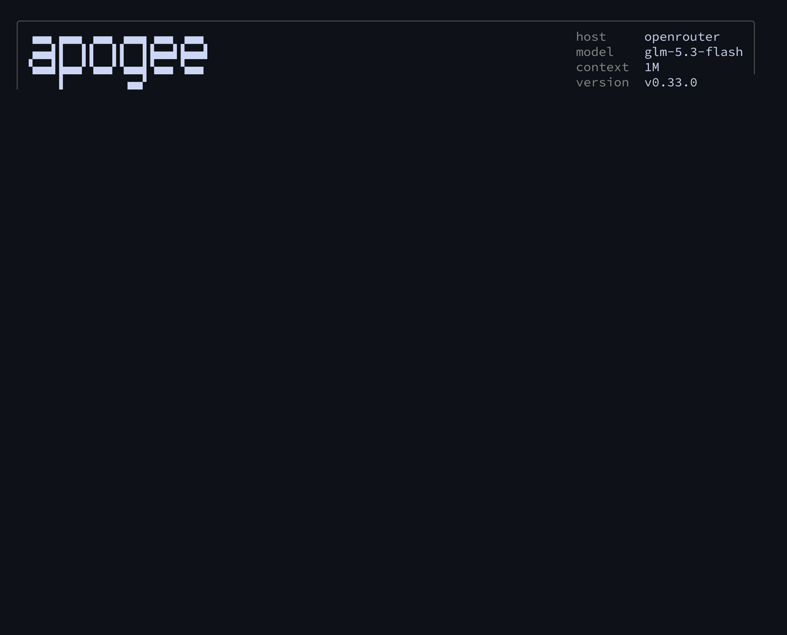

<p align="center">
  <picture>
    <source media="(prefers-color-scheme: dark)" srcset="graphics/apogee-logo-light.svg">
    <source media="(prefers-color-scheme: light)" srcset="graphics/apogee-logo-dark.svg">
    
  </picture>
</p>

# apogee — an open-source AI coding agent for local LLMs, in your terminal

<p align="center">
  <a href="https://github.com/airiclenz/apogee/releases/latest"></a>
  
  <a href="https://go.dev"></a>
  <a href="LICENSE"></a>
</p>

**apogee is a free, open-source AI coding agent that runs in your terminal.** You tell it
what you want; it reads your code, edits files, runs commands and tests, and keeps going
until the job is done. It is built for **local LLMs** — llama.cpp, Ollama, LM Studio, vLLM,
Splash — so your code never leaves your machine: no API key, no cloud, works offline. It
also runs on any OpenAI-compatible API, on OpenRouter, and on Claude through the Anthropic
API. One small binary for Windows, macOS and Linux.

<p align="center">
  
</p>

## At a glance

| | |
|---|---|
| **What** | A terminal AI coding agent: reads, edits, runs, tests, uses git, searches the web, delegates to sub-agents |
| **Models** | Any OpenAI-compatible server (llama.cpp, Ollama, LM Studio, vLLM, Splash, OpenRouter, …) and Claude via `wire: anthropic` |
| **Privacy** | Fully local with a local model. On its own, apogee only checks github.com for a newer release at start-up and runs a background `git fetch` against your repo's remote — [`update-check: false`](docs/manual/configuration.md#update-check) and `ui.git-fetch: false` turn them off |
| **Safety** | Four autonomy modes; the unsupervised one is fenced by the operating system |
| **Platforms** | Windows, macOS, Linux — `amd64` and `arm64`, one static binary, no runtime |
| **Install** | Homebrew, Scoop, a release archive, or `go install` |
| **Licence** | MIT |

## Why apogee

- **Small local models do real work.** Most coding agents assume a frontier model. apogee
  gives every model a *floor*: seven always-on guards that catch a model's own mistakes —
  a broken tool call is repaired, a tool call written as plain text is run anyway, a
  repeating loop is broken, an empty reply is retried, a model that talks instead of
  acting is told to act, a pointless re-read is cut short, a huge stale tool result is
  trimmed. They only step in *after* a mistake, so a big model loses nothing. The rule
  behind the whole project: nothing apogee adds may make a model do worse than the bare
  loop, and anything beyond the floor must prove itself on a benchmark before it ships on.
- **Autonomy fenced by the OS, not by a prompt.** Four modes run from read-only Plan to
  unsupervised Auto. Auto's commands are confined by the operating system — Linux
  landlock (or `bwrap` namespaces), macOS seatbelt, a restricted Windows token — so they
  cannot write outside your workspace. The few gaps an OS fence leaves are named when
  Auto starts ([details](docs/manual/configuration.md#auto-modes-blast-radius)); where
  the OS cannot fence at all, apogee asks before each command instead.
- **A complete agent in a calm, fast UI.** File edits, shell, git, tests, web, MCP
  servers, skills, parallel sub-agents, undo — in a terminal UI you can type into while it
  works, click through with the mouse, and fold down to what matters.

Under the hood apogee is an embeddable Go engine. The terminal UI is one front-end;
`apogee headless`, `apogee daemon` and the eval bench run on the same core.

## Install

Every route installs the same single binary.

**Homebrew — macOS and Linux:**

```bash
brew tap airiclenz/tap
brew trust --tap airiclenz/tap   # once per machine, on Homebrew 5.1+
brew install apogee
apogee --version
```

Prebuilt, nothing compiled. `brew upgrade apogee` updates it; `brew untrust --tap
airiclenz/tap` revokes the trust.

**Scoop — Windows:**

```powershell
scoop bucket add airiclenz https://github.com/airiclenz/scoop-bucket
scoop install apogee
apogee --version
```

The manifest checks the archive's `SHA256SUMS` hash. `scoop update apogee` updates it.

**winget — Windows (not live yet):**

```powershell
winget install AiricLenz.Apogee
apogee --version
```

The package's first submission to `microsoft/winget-pkgs` is still awaiting review, so
`winget install AiricLenz.Apogee` finds nothing yet — use Scoop or the archive below until
it lands. After that, `winget upgrade AiricLenz.Apogee` updates it.

**A prebuilt archive — Windows, macOS or Linux, `amd64` or `arm64`.** Every release
carries all six targets on the
[releases page](https://github.com/airiclenz/apogee/releases/latest), with one
`SHA256SUMS` file covering them all.

```bash
# macOS / Linux — resolves the latest release; to pin one, set VERSION=<x.y.z> instead
VERSION=$(curl -fsSL https://api.github.com/repos/airiclenz/apogee/releases/latest | sed -n 's/.*"tag_name": *"v\([^"]*\)".*/\1/p')
PLATFORM=darwin_arm64   # or darwin_amd64 · linux_amd64 · linux_arm64

curl -fsSLO "https://github.com/airiclenz/apogee/releases/download/v$VERSION/apogee_${VERSION}_${PLATFORM}.tar.gz"
tar -xzf "apogee_${VERSION}_${PLATFORM}.tar.gz"
sudo install -m 0755 "apogee_${VERSION}_${PLATFORM}/apogee" /usr/local/bin/apogee
apogee --version
```

On Windows, download `apogee_<version>_windows_arm64.zip` (or `_amd64`), unpack it, and
put `apogee.exe` somewhere on your `PATH`.

An archive install updates itself: `apogee update` fetches the latest release, verifies
it against `SHA256SUMS`, checks the new binary runs, and asks before swapping it in
(`--yes` skips the question; the binary's directory must be writable by you). The TUI's
start-up box tells you when a newer release is out and names the upgrade command for your
install channel — see [Updating apogee](docs/manual/updating.md).

The binaries are **not code-signed** yet. On macOS a *browser* download is quarantined —
`xattr -d com.apple.quarantine ./apogee` clears that (the `curl` above never sets it) —
and Windows SmartScreen may warn about an unrecognised publisher. `SHA256SUMS` is the
check worth making.

**From source:** clone and `make build` — see [Building from source](docs/manual/building.md).
Or, with Go installed: `go install github.com/airiclenz/apogee/cmd/apogee@latest`
(`@main` and `@<sha>` work too).

## Quick start

```bash
apogee
```

On first run apogee writes a commented starter config to `~/.apogee/` and asks which
server to use. Or skip the config and point one session straight at a server. No GPU? A
free OpenRouter model works (get a key at [openrouter.ai/keys](https://openrouter.ai/keys)):

```bash
export APOGEE_API_KEY=sk-or-your-key
apogee --endpoint https://openrouter.ai/api --model google/gemma-4-31b-it:free
```

or a local server:

```bash
apogee --endpoint http://localhost:8080 --model qwen3-coder
```

Then type what you want done.

| Key | Does |
|---|---|
| `Shift+Tab` | Cycle the autonomy mode: Plan → Ask-Before → Allow-Edits → Auto (`--mode plan` starts in Plan) |
| `/` | Open the command menu |
| `@` | Reference a file (or attach an image) |
| `esc` `esc` | Stop the run |

The full tour is in [the manual](docs/manual/README.md).

## What apogee can do

### Models and servers

- **Any OpenAI-compatible endpoint**, local or remote. A local llama.cpp, Ollama, LM Studio,
  vLLM or Splash server keeps every byte on your machine and needs no key.
- **Claude over the Anthropic API** — a server entry with `wire: anthropic` speaks the
  Messages API directly, with the same tool loop and guards.
- **Keys stay out of your config file.** A server can read its key from a command or an
  environment variable; apogee offers to move a plaintext key into the macOS Keychain or
  a Linux Secret Service keyring.
- **Model profiles** fit models without native tool calling: tool menus sent as text,
  calls parsed back out, thinking stripped — while native models stay byte-identical on
  the wire. Profiles for Gemma, gpt-oss, `minimax-m3` and `qwen3.8` ship built in, and a
  profile can trim the tool list so a small model sees fewer, clearer tools.
- **Switch live.** `/model` and `/server` move the session; `/effort` sets how hard the
  model thinks.
- **Fallback servers** — when a server fails, a run moves to a backup mid-turn
  ([`fallback:`](docs/manual/configuration.md#moving-to-another-server-when-one-fails--fallback)).
  A local llama-server still loading its model is waited for, not treated as down.
- **Sub-agents on a different server** — a small model steering while a big one does the
  heavy reading, or the reverse (`/sub-agents-server`).
- **[llama-launcher](https://github.com/airiclenz/llama-launcher) integration** — load,
  switch, unload and stop local model servers from `/model`, `/unload-model` and
  `/stop-server`.

### The agent

- **36 built-in tools** (30 on the default menu): read, write, edit, copy, move and
  delete files, grep and find, git, terminal, Python, diagnostics, test runners, web
  fetch, web search and HTTP, a task list, questions back to you, skills, documents it
  presents to you, and sub-agents.
- **Parallel sub-agents**, each with its own context window and a token, time and step
  budget. Open one full-screen to watch it work, and type to it while it runs.
- **Workflows** — one brief over many items, each done by a fresh sub-agent that reports
  back one line, so fifty items cost fifty lines, not fifty conversations. Save one as a
  recipe and start it with `/name`, or send it to the background with `/bg`. See
  [Workflows](docs/manual/workflows.md).
- **Skills** — short markdown playbooks you run with `/name`. Five ship built in
  (debugging, planning, code review, commit hygiene, code audit); add your own in
  `~/.apogee/skills` or ship them in a repository. apogee suggests a fitting skill as you
  type; `Tab` picks it.
- **`AGENTS.md`** at the workspace root goes into the system prompt automatically.
- **MCP servers** over stdio, SSE or streamable-http, with OAuth login
  (`apogee mcp login`) and an `env-allowlist:` so a server sees only the environment you
  name. `/mcp` shows each server's state and tools; a crashed server is reconnected.
- **Long tasks fit the context window** — apogee compacts the conversation, trims stale
  tool output and skips re-reading unchanged files. A live gauge shows how full it is.
- **Reads more than code** — PDFs as text, page by page; images for a model marked
  [`vision: true`](docs/manual/configuration.md#images--vision) (`@shot.png` or paste
  with `⌃v`); and, on a Go project, the standard library and module cache, read-only.

### Safety and control

- **Four autonomy modes** — **Plan** (read-only, apart from its own scratch directory),
  **Ask-Before** (asks before every write and command), **Allow-Edits**, and OS-confined
  **Auto**. `Shift+Tab` or a click on the footer switches at any time, even mid-run;
  `/confine` shows or changes [Auto's blast radius](docs/manual/configuration.md#auto-modes-blast-radius).
- **A dangerous-action guard in every mode** — destructive commands are refused, alarming
  ones are shown to you first, and a `git commit` carrying a secret always asks. Tune it
  with [`dangerous-rules:`](docs/manual/configuration.md#adding-and-removing-rules--dangerous-rules).
- **Approvals mean what you think** — scoped to the exact call, honoured across all
  sub-agents, and shown with the real path the call resolves to.
- **Network allow and deny lists** for the web tools and MCP endpoints; private and
  link-local addresses are refused by default. Tool subprocesses never see your API key
  (see [SECURITY.md](SECURITY.md) for the exceptions).
- **`/undo` and `/redo`** — put back everything an exchange changed, one exchange at a
  time, with a preview first. apogee snapshots the workspace, so a shell command's writes
  are undoable too, and the history survives a restart: `apogee undo <session-id>`
  reverts an unattended run.

### The terminal UI

- **Type while it works.** Queue your next message into the running task, or a command
  for when it is idle; recall any earlier prompt; select text mid-stream.
- **Read what matters.** Tool calls are summed up in one line ("Read 3 files, ran 4
  commands") and fold away once the model moves on; fold or unfold any block yourself.
- **Side panel** on wide terminals — sub-agents, tasks, changed files, usage and MCP
  servers at a glance. Pin, fold or resize its sections, or set it with `/panel`
  ([details](docs/manual/configuration.md#the-side-panel)).
- **Mouse everywhere** — every approval, picker and menu works with two clicks; the
  footer's mode marker and git segment are clickable. Paths print as plain text, so your
  terminal's own cmd/ctrl-click opens them.
- **Git from the footer** — fetch, pull, push, sync, switch branch or rebase from a click
  or `/git`; the footer keeps the branch's ahead and behind counts current.
- **Side-by-side diffs** for every file the agent writes.
- **See inside** — `/thinking` shows the model's reasoning, `/inspect` every model call
  (timings, tokens per second, and the raw request when enabled), `/usage` the cost per
  agent and sub-agent, in your currency once a server has a `price:`.
- **Notifications** — a bell or desktop notification when an approval waits or a turn
  ends while the window is in the background (`ui.notify`).
- **Colour schemes** — built-in `dark` and `light`, or your own YAML file, switched live
  with `/color-scheme`.

### Sessions, schedules and scripts

- **Sessions that survive anything** — every turn autosaves. `apogee --continue` resumes
  the last one, `/sessions` browses, renames and deletes, `/fork` branches from any
  earlier prompt, `/continue` picks up an interrupted task. See
  [Sessions](docs/manual/sessions.md).
- **Watch a running session** — a session in another terminal, a headless run or a daemon
  job shows as `● live` in `/sessions`; open it to follow along read-only. See
  [Watching a live session](docs/manual/sessions.md#watching-a-live-session).
- **Scheduled prompts** — `/schedule` repeats a prompt while apogee is open;
  [`apogee daemon`](docs/manual/daemon.md) runs standing schedules under your OS's
  service manager (`apogee daemon install` writes the systemd, launchd or Task Scheduler
  unit).
- **Scriptable** — [`apogee headless`](docs/manual/headless.md) runs one prompt
  unattended with clean stdout, meaningful exit codes, turn and time budgets
  (`--max-turns`, `--max-wall-time`), and a JSON event stream with `--format json`.
- **Reactions** — run a command, POST a webhook or call an MCP tool when something
  happens (an exchange ends, a file changes, an approval waits); a `gate:` can block or
  hold a tool call, and an `advise:` can hand the model a fact. See
  [Reactions](docs/manual/reactions.md).
- **[`apogee probe`](docs/manual/probe.md)** reports what this host, model and terminal
  can do, what your config resolves to, and how many tokens apogee sends the model on
  turn 1.
- **Reports you actually see** — a finished document opens on your desktop, or is served
  over a one-off link when apogee runs on a remote machine.

### Configuration

- **`/settings`** shows every setting, where its value came from, and edits one key at a
  time with your comments and layout kept.
- **Live config** — edits to `~/.apogee/config.yaml` or the project's
  `.apogee/config.yaml` apply to the running session.
- **Project config** — a repository can ship settings, MCP servers, reactions and
  `allow:` rules (such as `go test`); they take effect only after you adopt them
  (`apogee project adopt`), because allowing a command runs whatever the repo's code does.
- **Your own system prompt** — replace apogee's, add to it, or give one model its own.
- **Turn any tool on or off**, for every model or for one — a shorter tool list often
  makes a small model better.

## FAQ

**Does apogee work offline?**
Yes. With a local model server, your code and prompts stay on your machine. Set
`update-check: false` (start-up release check) and `ui.git-fetch: false` (background
`git fetch`) and apogee makes no network request of its own.

**Which models work best?**
Any model with tool calling works natively; models without it work through a profile.
apogee is tuned to make small local models (Qwen, Gemma, gpt-oss and similar) useful,
and works as well with large ones, including Claude.

**Is it safe to let it run on its own?**
Auto mode is fenced by the operating system, so its commands can't write outside your
workspace, and destructive commands are refused in every mode. Plan and Ask-Before keep
you in the loop for every change, and `/undo` reverts an exchange.

**Can I use it in VS Code, Zed or another IDE?**
Yes — it runs in any terminal, including the one built into your editor.

**Can I run it in CI or a script?**
Yes — `apogee headless` runs one prompt unattended; `apogee daemon` runs prompts on a
schedule.

## Documentation

The [manual](docs/manual/README.md) is the full reference:

| Page | Covers |
|---|---|
| [Commands](docs/manual/commands.md) | Every in-chat command and key, skills, `@file` references, `/undo` and `/redo`, `/settings`, `/git`, `/mcp`, `/panel` |
| [Sessions](docs/manual/sessions.md) | Saving, resuming, forking, browsing and renaming conversations; watching a live one |
| [Configuration](docs/manual/configuration.md) | `config.yaml` end to end: servers, wires and fallback, API keys, model profiles, tools, the Floor guards, the system prompt, the UI and side panel, Auto's confinement |
| [Workflows](docs/manual/workflows.md) | One brief over many items: `fan_out`, recipes, `/bg` background runs, `/workflows` |
| [Reactions](docs/manual/reactions.md) | Commands, webhooks and MCP tools fired on session events (`run:`), advice to the model (`advise:`), gating tool calls (`gate:`) |
| [`apogee probe`](docs/manual/probe.md) | What a host, model and terminal can do; what the config resolves to; what the model is sent at turn 1 |
| [`apogee headless`](docs/manual/headless.md) | One unattended prompt for scripts and CI; budgets; the JSON event lines |
| [`apogee daemon`](docs/manual/daemon.md) | Standing schedules that outlive the session |
| [Updating apogee](docs/manual/updating.md) | The update notice, each install channel's upgrade command, `apogee update` |
| [Building from source](docs/manual/building.md) | Prerequisites, Makefile targets, cross-compilation, the release runbook |

Working on this repo *with* a coding agent? [`AGENTS.md`](AGENTS.md) is the agent-facing
map — where the docs live and the conventions the code doesn't show.

## Status

**Pre-production `0.x` on `main`.** Under SemVer, `0.x` makes no API-stability promise —
the Go API may still change — but every release ships prebuilt binaries for all six
targets, a Homebrew formula and a Scoop manifest. The agent itself is complete: full tool
suite, MCP client, parallel sub-agents, skills, sessions, schedules, and OS-confined Auto
on all three platforms. Recent changes are in the [CHANGELOG](CHANGELOG.md); planned work
lives in the issue register (capcom, `.capcom/`).

## Why Go

Portability. Go cross-compiles to one static binary with no runtime, and one language
covers both the agent and the bench that evaluates it. The TUI is built on the Charm stack
(Bubble Tea, Lipgloss, Bubbles) with Cobra for the CLI.

## License

MIT — see [LICENSE](LICENSE).
